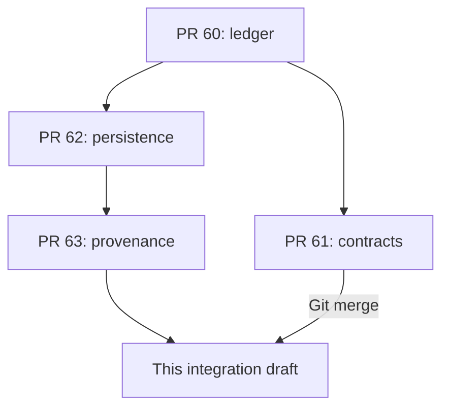

# Stage 2C-2 — isolated authenticated financial commands

No application route/component imports this service. No real accounts, financial
records, Square calls, secrets, rules, IAM or deployed environment settings are
read or changed. All writes during verification are disposable local emulator
fixtures. The service is a server library, not an enabled product workflow.

## Git integration and dependency graph

Branch starts at PR #63 `085a4e31f9695fdc72b591715942b99c4c12c1f1`.
PR #61 `f9a07979ee40d9455c1f1167cdccbfc22c6b98a1` was integrated with
`git merge --no-ff`; the only conflict was package.json's test script, resolved
by retaining both agreement and offline reconciliation tests. All agreement module,
agreement test and policy/offers documentation bytes remain identical to #61.
The integration commit has both upstream heads as parents. The implementation is
a subsequent commit; contracts were not recreated or manually copied.



This draft targets `feature/stage2c-legacy-reconciliation`, not main. No existing PR
is modified or merged. Eventually #60 precedes #61/#62, #62 precedes #63, and this
integration requires both #61 and #63. Merging this draft into #63 prematurely
would also bring in #61; do not do so without explicit integration/merge approval.
After approved upstream merges, update/rebase and retarget the draft as appropriate
and repeat tests. Regular merges preserve ancestry; squash/rebase upstream merges
may require reapplying only the implementation commit onto a new updated base once
both dependencies are present. Do not re-copy contracts or duplicate money history.

## Authentication and current authorization

`lib/financial-commands/service.mjs` takes an actual Firebase Admin Auth instance,
Firestore client and explicit project ID. It initializes no SDK and discovers no
credentials. Firebase `verifyIdToken(token, true)` runs outside retry callbacks;
UID, issuer, audience, expiry, issued/authentication times are additionally checked.
Only the verified UID is used. Browser actor IDs, role flags, balances, provider
objects and arbitrary approval fields are rejected by strict envelopes/contracts.
Trusted non-Firebase service-principal authentication is not implemented.

Inside every posting/retry (including duplicate recovery), load
`financialCommandPrincipals/{verifiedUid}` and check active/current role revision,
application revocation epoch, allowed actions, client scope and explicit project
scope. Project registry ownership is checked server-side. Receive replay uses its
immutable journal's original project so losing project access also blocks replay.
A 15-second authorization lease and token/approval expiry are rechecked before
commit. Failed lease checks roll back queued writes; retry with the same operation ID.

Principal provisioning is not wired to existing browser `adminUsers`, user custom
claims or any public writer. Role/client/project grants must eventually be managed
by a separately secured privileged process. Accepted actions are client consent;
admin/owner receive, booking attendance allocation and membership-cancellation
financial journal; owner-only approval and transfer. Owners need explicit scopes,
not a wildcard. Owner approval and execution currently require the same owner;
delegation, two-person approval, MFA/step-up and service identities are future work.

Firebase revocation is checked when a command enters. Firebase Auth and Firestore
are separate services: revocation after verification cannot be atomically observed
without the server-owned application revocation epoch being updated. The short
lease limits that window; a production revocation/disable-to-role bridge is still
an activation gate. Do not claim zero race across those two backends.

## Consent and provider evidence

`accept()` accepts only request ID, exact displayed-request hash, affirmative true
and the exact separate offer-term references. Context/client identity/time come
from verified authentication, role lookup and server clock. It loads the current
PR #61 agreement/published policy and appointment revision. Client role and UID must
match the request. No optional marketing consent is bundled or inferred.

Create-only consent/operation/audit records retain the receipt **and full request,
policy and appointment snapshots**. First-use full-policy definition guards prevent
same-version structured-rule changes even when policy text hash is unchanged.
Financial execution loads those records, checks their durable client-acceptance
audit, and applies PR #61 `requireAcceptance` against current exact amounts,
appointment/revision and terms. Missing, stale, modified and fabricated acknowledgments
fail before financial writes. UI delivery/copy of terms is not implemented.

A Square link, referral or payer's card is not evidence of website consent. This
service proves only that the authenticated request client accepted the specified
terms; it cannot prove a different person using a forwarded link read or accepted
them, or identify the actual card payer. Third-party payer policy remains an owner/
legal decision. Never label provider payment success as payer policy acceptance.

Receipt posting requires normalized Stage 2A COMPLETED/CARD/versioned readback
information, an additional readback-proof hash with CAPTURED card state and no
external details, and trusted request/order/merchant/location/amount linkage.
Readback proof must be no older than five minutes. Missing/contradictory evidence
fails without consuming operation/provider keys. No Square API call occurs here.
The verifier/order/evidence ingestion service and its permissions are not implemented;
a hash or verifier ID alone does not authenticate an upstream writer. Existing
historical EXTERNAL flags must never be promoted into trusted proof.

## Atomic owner approvals and financial persistence

`approveTransfer()` creates a separate durable owner decision and audit. It binds:
- the complete command/envelope including operation ID, amount, target and source;
- client/environment, current account revision and exact current restrictions;
- policy definition/version and acceptance reference;
- issuing owner, role revision, authentication time and a maximum 15-minute expiry.

Execution checks current owner status, approval audit/hash, full binding and expiry,
then creates an `approvalUses/{approvalId}` record atomically with journal, lots,
account projection and execution audit. Another operation cannot change amount,
restriction, target, client or expected revision to reuse the grant. Exact retries
recover the original entry; they do not consume approval again. Role revocation or
stale source/approval fails closed. Audit records store full decision payload plus
its hash, actor/role revision, client/environment and server time; tokens are never
stored or logged. Failed requests do not produce committed financial audit entries;
privacy-safe denial telemetry/rate limiting is future work.

Stage 2B now has optional transaction guards and intent context. Guards read only
inside the SDK callback and return a write-only closure, executed after all bounded
reads. There are no Auth, Square or other external calls in retry callbacks. Existing
low-level calls retain their original intent format. Transfer requires a guard;
only the protected service should be connected to a future route. The low-level
server adapter is not itself an authenticated product API.

The pure ledger adds `transfer`: source purchased lot gains additive
`transferredCents`; target purchased lot retains original provider funding and
origin-lot reference with cleared restrictions. Remaining value is now
`funded - used - refunded - transferred`. Historical lots without this field mean
zero transferred value. Two purchased-liability lines balance to zero; no cash,
promotional value or earned revenue is created. Before/after snapshots support
independent replay/reversal. Adapter reads at most two affected lots, including
multi-lot reversals. Old v1 entries/schemas are unchanged and remain reconstructable;
consumers must use the updated balance functions, not an old remaining-value formula.

PR #61 `planStudioTransfer` is reused against actual lot remaining/reserved value,
accepted policy and owner context. Pending legal/accounting review, booking fees,
composite receipts, holds or insufficient eligible value cannot be bypassed. New
service receipts preserve fee and advance as separate immutable booking allocations,
although their full receipt remains one Stage 2A funding lot. Composite receipts
cannot transfer until a separately reviewed split command exists. Only full booking
attendance is exposed here: both allocations apply once; partial booking allocations,
generic Studio Credit spending, rescheduling, refunds, compensation and forfeiture
are not service commands. The low-level engine retains its earlier tested operations.
The transfer service currently permits Tattoo Credit only, not direct appointment-
advance conversion or chains of general-credit transfers. Spending transferred
target value is explicitly disabled here. Future refund/dispute freezing must
cover every descendant of the original provider funding, not just its source lot;
that funding-family enforcement and generic credit spending are activation gates.

Purchased cancellation value is preserved: the financial cancellation command is
a no-op journal, not a Square billing/membership workflow. Non-cash offer expiry
uses unchanged PR #61 contracts and never mutates funds. Offer redemption and bonus
issuance are not enabled. Approval of a transfer does not authorize any other command.

## Data layout and immutable provenance

Existing `financialLedger*` paths remain. New account subcollections are agreements,
consents, consentOperations, appointments, projects, values, bookings, approvals,
approvalUses, readbacks and providerOrders. Global financialAgreementPolicies and
financialAgreementPolicyGuards hold immutable versioned definitions/first-use hashes;
financialCommandPrincipals is privileged current authorization state;
financialCommandAudits holds create-only decisions. These are proposed namespaces,
not created in any real database. Value projections/booking application state update
only in the same transaction as their financial effects.

Original provider evidence stays in immutable journal commands and funding-lot
references. Transfer source/target/value/audit references retain that origin. PR #63's
stable `sourceKey`/`importId` contracts are reused to detect consumed legacy sources;
reserved `legacy_` IDs cannot be treated as new receipts. All legacy-import requests
remain disabled, even with an otherwise matching offline report. No migration,
opening-entry command or provenance-guard bypass was implemented.

## Verification and commands

```sh
npm ci
npm run test:contracts
npm run test:ledger
npm run test:legacy-import
CI=true npm run test:ledger:emulator
npm run test:commands:emulator
npx eslint lib/financial-commands tests/financial-commands scripts/test-financial-commands-emulator.mjs lib/ledger/server/firestore.mjs lib/ledger/engine.mjs tests/ledger/transfer.test.mjs
npm test
npm run lint
npm run build
```

Use Node 22+ and Java 21+. The new runner selects only demo-fawcett-ledger,
loopback Auth 9097 and Firestore 8087 and a dedicated local config. Fixtures reject
any other host/project before creating clients. A test-process TCP guard rejects
nonlocal SDK connections. CLI CI mode suppresses its unauthenticated public MOTD
lookup; initial public emulator binary installation is tooling, not project access.
No credentials, session tokens or real financial data are printed/exported. Test
rules are the existing deny-all emulator fixture; no deployed rules are changed.

Auth tests use actual local Admin SDK token verification and Auth-emulator account
disabling/revocation, not a fake authorizer. Expiry boundaries use a controlled
server clock; emulator-issued tokens are unsigned and do not prove production
signature/certificate verification. Role fixtures/deny-all local rules likewise
do not prove live grants, IAM or deployed rules. The noncash expiry regression
combines the pure offer transition with a persisted account check; no persistent
offer redemption/expiry adapter is enabled.

## Activation gates and next increment

All new paths need separately reviewed browser deny rules and least-privilege IAM;
Admin SDK bypasses rules and privileged administrators can forge data. Create-only
application writes/hashes are not tamper-proof WORM storage. Keep audit/approval,
policy and verifier writers separately governed with protected retention/backups.
Session revocation synchronization, MFA/step-up, rate limits/denial telemetry,
request/appointment version provisioning, trusted verifier ingestion, generic credit
commands and legal/business-policy decisions remain unimplemented or unverified.
HTTP body limits, CSRF/origin checks and API abuse controls belong to a separately
reviewed future transport layer; no HTTP handler exists in this increment.
Do not turn on real workflows based on emulator success.

No owner action is needed for this isolated increment. Future owners must separately
approve real-project role/evidence provisioning and policy/legal/accounting terms,
any read-only legacy-data procedure, staging tests with exact data/cleanup scope,
then actual route/UI activation and financial command scope. No such changes are
authorized here. Next increment: read-only admin command/decision preview and a
reviewed provisioning/revocation design, with emulator contract checks before any
real-project deployment, migration or client-balance cutover.

References: https://firebase.google.com/docs/auth/admin/verify-id-tokens ;
https://firebase.google.com/docs/auth/admin/manage-sessions ;
https://firebase.google.com/docs/emulator-suite/connect_auth .

Verified locally: 18/18 policy contracts, 21/21 ledger tests (19 inherited plus
two transfer/reconstruction tests), 26/26 offline provenance tests, 19/19 inherited
Firestore emulator tests and 20/20 combined Auth/Firestore command emulator tests.
Scoped ESLint, whitespace and production build (36 pages) pass. Full suite:
110/111, with the existing Jane/Janet client-search expectation failure. Repository
lint retains the existing apostrophe error in AdminSquareInvoiceAssistant.js:164
and three image warnings. No unrelated source changes address these baseline issues.
