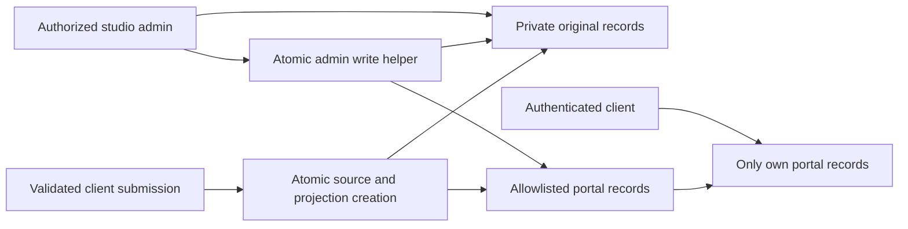

# Client privacy boundaries and migration plan (Phase 1)

## Scope and evidence

This change was developed from `codex/fawcett-current-work` after PR #32, using only synthetic emulator records. No production Firebase records, Auth accounts, deployed rules, Vercel settings, payments, or notifications were accessed or changed. This document is a plan, not an executable migration. The repository's rules do not prove which rules are deployed in Firebase Console.

The previous rules allowed owners to read entire source documents. `AdminClients`, `AdminConsults`, `AdminApplications`, `AdminProjects`, `AdminPayments`, membership review components, and intake review components store private fields in those documents. Firestore cannot hide individual fields on a readable document. Hiding them in JSX does not prevent direct SDK/REST access.

The new model retains those original source documents as admin-only readable records. It publishes separate, allowlisted documents at:

```
{collection}/{originalId}                         # private original
portalRecords/{collection}/records/{originalId}   # client-visible projection
```

The original ID, Auth `clientUid`, and consult/application/project/conversation/appointment/payment references stay unchanged. All unrecognized fields are excluded from projections; field allowlists are in `lib/portalProjection.mjs` and the proposed rules. This is a new physical read boundary, not UI-only filtering.



## Collection audit and classification

| Source collection | Client-visible information | Kept private |
| --- | --- | --- |
| `clients` | Own contact details, client status, artist preference | `adminReview`, internal notes, editor identity/time inside review, administrative statistics |
| `consultRequests` | Own request, contact preferences, submission status and project/conversation links | Entire `readiness` health block, admin review/summary, staff Auth identifiers and undeclared routing data |
| `membershipApplications` | Own application/project/budget/timeline, acknowledgements and published offer terms | Health/readiness, review notes, offer working notes, draft offer contents, staff/editor identities |
| `projects` | Own project, estimates, disclosed costs, source links, intentionally client-facing summary | Copied health/readiness, all other `adminReview` fields and nested estimate editor identity |
| `conversations` | Own subject, artist inbox, message preview, read state and source links | Intake review, internal notes, staff Auth identifiers and undeclared routing data |
| `messages` | Own conversation's intentional message text and public sender role/name | Review fields and staff/Auth sender UID; original source message body remains immutable through browser rules |
| `appointments` | Own appointment details, location and `clientVisibleNotes` | Generic/internal notes, staff metadata and other undeclared fields |
| `payments` | Own recorded amounts, method/status, credit handling and project/appointment relationships | Administrative notes, bookkeeping reference, editor identity and internal provider/policy details |
| `creditLedger` | Own credit movement, declared description/reason and related IDs | Administrative notes, private references, staff metadata and undeclared fields |
| `membershipOffers` | Own approved offer terms/status and links | Notes, review/editor fields and other undeclared operational fields |
| `membershipOfferResponses` | Own submitted response, application link and response status | Admin notes, reply drafts and review/sender metadata |
| `membershipChangeRequests` | Own submitted request, acknowledgements and review status | Admin notes, reply drafts and staff review metadata |
| `projectTimeline` | Own explicitly published non-health updates | Private entries, health/skin entries regardless of the old visibility flag, creator/editor identities |
| `founderProfiles` | Existing authenticated server API's `safeFounderProfile` result | Raw document access is now admin-only; server-only fields are not returned by the safe API |

Existing `paymentOrders`, checkout request/rate-limit state, webhook events, founder counters, transactions and contributions retain their existing server-write restrictions and browser-read restrictions. The public campaign API returns aggregate counts/totals, not a client directory. `adminUsers` remains self-readable for role checks and unwritable by browsers.

The fixed artist catalog references already used by the forms (`artist_ben`, `artist_autumn`, `ben`, `autumn`, or null) remain usable for routing new conversations. Arbitrary staff/Auth identifiers are excluded and forbidden in projections. During migration, resolve other artist identifiers privately instead of exposing them.

Health is no longer automatically echoed into the generated consultation chat summary. It remains in the private original consultation/application and in any private project copy for authorized staff. Intentionally authored chat messages and approved summaries are sharing channels: do not paste private notes into them. A schema cannot identify every sensitive statement inside free text.

Storage uploads are not implemented in the inspected components; only SDK initialization exists. Production bucket rules, external reference-link sharing permissions, backups and third-party copies were not audited against live settings. This PR does not claim to protect those systems or deploy Storage rules.

## Application and authorization behavior

- Admin components continue reading original collections and retain review/health editing behavior. `lib/adminFirestore.js` updates originals and approved projections in one transaction, replacing the whole projection to remove withdrawn fields. Source originals are not deleted.
- Portal components use `lib/portalFirestore.js` for reference creation and writes. Own submissions create the original and projection atomically. Clients cannot read the original, including the health they submitted; they receive the approved portal subset.
- Client-created projections must exactly match allowed subsets of a newly created, validated own source. They cannot publish an existing private record, promote themselves, inject admin review fields, or alter owned project/payment records.
- Authorized admins are trusted publishers of allowlisted, typed client-facing content. Projection ownership and relationship IDs are bound to the source; normal application transactions derive the projection from the source. Admin publication does not rewrite original message history.
- Message creation checks sender identity/role, conversation ownership and linked application/consult ownership. Cross-client and missing source references are denied. Client conversation updates are limited to preview/read-state metadata.
- Portal queries must constrain `clientUid`; timeline queries also constrain `clientVisible`. IDs alone do not authorize access. Unknown portal namespaces and unspecified deeper paths are denied.
- Portal record state clears on Auth transitions; old-account snapshot results and delayed dashboard/Founder API responses are discarded.
- Health/skin timeline updates cannot be published. Withdrawing a public timeline entry deletes only its derived view, preserving the original.

## No automatic migration

An ordinary admin edit of a legacy original with no projection **does not create a projection**. This includes old message bodies that may contain health details. Source records remain readable/editable by authorized admins and await an approved migration. An explicit admin action to publish a non-health timeline entry or release a standalone offer with a published status is an intentional sharing action, not a background backfill.

The seed script only creates fixed synthetic example.test accounts and records in the demo emulators. It publishes projections for those fixtures; it is not a migration tool. There is no production export/import, UID relinking, automatic Auth-account creation, password creation, payment recomputation or notification backfill in this PR.

## Required approved migration and cutover

1. **Verify the actual production project and policy outside Codex.** Compare the live Vercel deployment's Firebase identity, Firebase project ID, current rules, enabled server writers/functions/extensions and Auth configuration. A project called “Sandbox” containing real clients is still production. Do not place its values or data in Codex.
2. **Preserve a recoverable backup in a controlled production administration environment.** Preserve original documents, IDs, timestamps, Auth UIDs and relationships. Include linked Storage data if used. Do not put that backup, client exports or live credentials into this workspace.
3. **Inventory and review records privately.** Determine which field values may be client-facing. Verify each `clientUid` against the intended Auth account and every linked record's ownership; quarantine missing/mismatched UIDs, ambiguous profiles and cross-client relationships. Do not infer ownership from an email match or document-ID fallback.
4. **Prepare allowlisted projections at the same IDs.** Do not move/delete original notes or medical information: originals become the private system of record. Exclude all review/staff/health fields and private financial references. Do not publish drafts or private/health timeline entries. Check legacy amount aliases and timestamp types so balances/appointment behavior remain consistent.
5. **Review free-text history separately.** Earlier consultation summaries contain a `Health / Notes` section inside `messages.body`; conversation previews, appointment notes, project descriptions or other free text may also contain information that should remain private. A field-name allowlist cannot safely redact this. Keep suspect messages private and unprojected rather than changing the original body. If a conversation preview contains private content, an independently approved operation can replace that ephemeral preview with a safe generic value, preserving the actual original messages. Any additional redaction/publication workflow needs separate approval and must prevent later edits from republishing the original sensitive text.
6. **Validate a migration dry run with synthetic equivalents.** Verify counts of eligible views and intentionally withheld records; ensure source/UID/relationship integrity, no private keys or staff metadata in projections, and correct user-scoped query results. Exercise existing portal query shapes and required production indexes; emulators do not establish production index readiness. Rehearse rollback without reopening private source reads.
7. **Coordinate frontend, rules and writers under an approved cutover.** The new frontend depends on the new namespace and rules. The new rules deny old clients' source reads; the old rules deny the new namespace. Do not ship only one half. A controlled maintenance window is safer than temporarily allowing legacy private reads. Configure every authorized non-browser source writer to maintain or explicitly withhold the corresponding approved view; Admin SDK bypasses Firestore rules.
8. **Reconcile changes made during preparation.** Use a write pause or approved revision-based catch-up to prevent stale projections. Deploy only after separate approval, verify the live rules and fresh authenticated sessions, and keep payments/notifications disabled unless separately authorized. No rule deployment or migration is performed by this PR.

Legacy clinical message summaries can remain permanently private while their original content, IDs and associations are preserved. Clean original messages can be projected after review. Keep a restricted migration manifest of what was deliberately withheld; never fabricate replacement history or financial balances.

## What remains at risk until production enforcement

**This PR does not secure the live database by itself.** If the previous checked-in owner-read policy is still deployed, owners may still retrieve whole source documents containing `adminReview`, internal notes, `readiness` health data, copied project health/review fields, appointment internal notes, payment/credit references, staff identifiers, draft offers and health timeline entries marked visible. Old generated consultation messages may also contain health text.

Publishing clean portal records alone does not close that exposure: the original collection reads must be restricted by the approved rules cutover. After the new rules are actually enforced, unmigrated originals are private even before backfill, but clients will not see their legacy history until reviewed projections exist. Existing raw Founder profiles must also lose owner read access; the safe authenticated API remains the client interface.

No production record was inspected, so this audit does not establish which real records contain those fields, what policy is currently deployed, or whether a client accessed them. Previously delivered data, cached pages, exports or copies cannot be retroactively withdrawn by changing rules. Any review of actual exposure must happen separately in an authorized production administration context.

## Local review and validation

Use only the Phase 0 demo emulators. Run `npm run lint`, `npm run build`, and `npm test`. The privacy suite exercises every mapped source collection, owner/non-owner/anonymous/inactive-admin cases, direct source reads, unconstrained queries, forged projections, nested field injection, sender impersonation, missing/cross-client links, immutable message text, legacy non-publication, health timeline withholding, draft offers and complete source/projection workflows.

No production secrets or new service credentials are required. No dependencies were added. The final test counts and PR validation evidence are recorded in the PR description.

## Final SDK compatibility audit

All current imports of `lib/portalFirestore.js` were reviewed in the dashboard,
projects, timeline, appointments, credit, membership offers, messages, portal login,
consult and membership forms. Reads retain native Firebase query/snapshot APIs.
The adapter supports the patterns used here: `collection(db, name)`,
`doc(db, name, id)`, slash-separated root paths, `doc(collectionRef, id)`,
`doc(collectionRef)` with an auto ID, `addDoc(collectionRef, data)`,
`setDoc(documentRef, data)` and conversation `updateDoc(documentRef, patch)`.
Collection-relative IDs are resolved inside the mapped collection, without a
second root-name translation. Private collection references are rejected.
These are purpose-specific atomic source/projection writers, not a general SDK
replacement: portal callers currently use no set options, converters, nested
collections or field/value update overloads. Historical admin merge-write
regression coverage remains in the emulator suite.
Phase 2 moved studio client editing to a server-only API; its legacy client panel
is read-only. See [studio management](admin-client-management.md).

A verified existing Auth user whose legacy client has no projection receives an
absent own-profile snapshot and empty projected history, without any fallback to
private originals. A portal profile creation attempt cannot overwrite that source.
An admin contact edit preserves private notes and leaves the projection absent.
Migration must explicitly review and publish an eligible profile at the original
ID with its verified UID; neither signup nor ordinary edits substitute for that
approval. These temporary empty portal states are an intentional cutover limitation,
not evidence that legacy records have been deleted.

Phase 3 adds an [emulator-only approved rehearsal](migration-rehearsal.md), an [owner inventory checklist](production-inventory-checklist.md) and a [gated cutover/rollback runbook](production-cutover-runbook.md). These do not execute or authorize a production migration.
